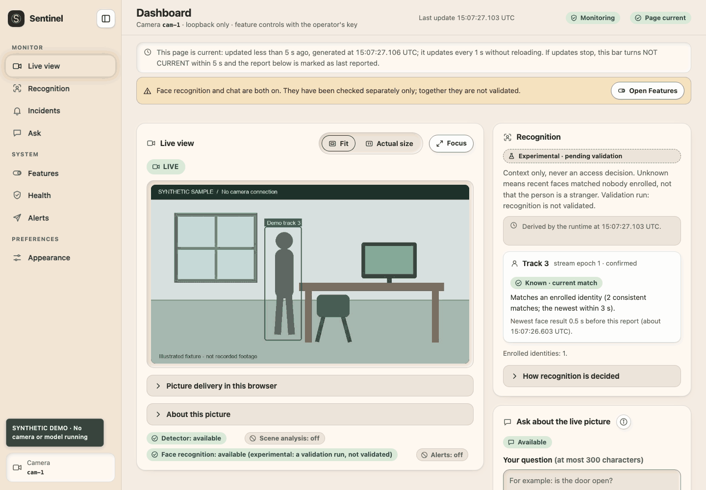
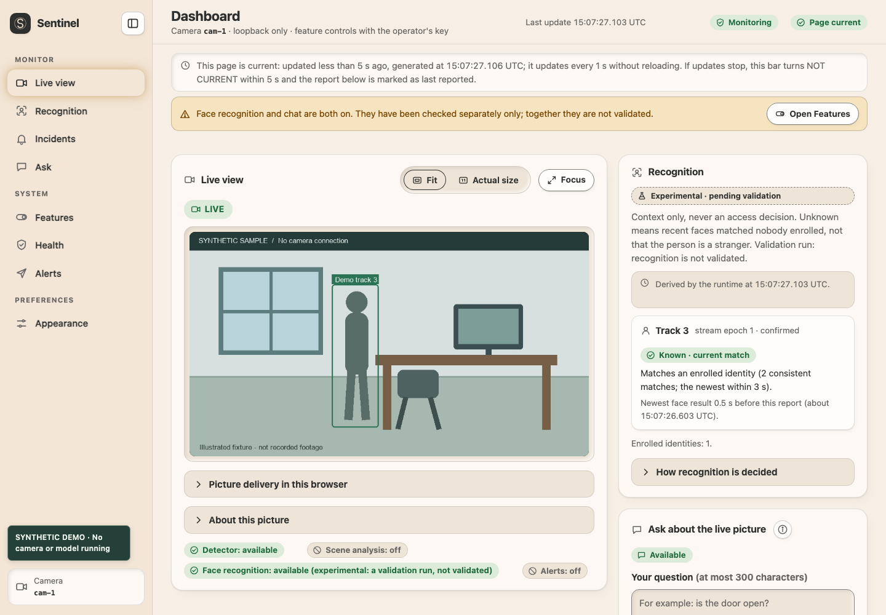
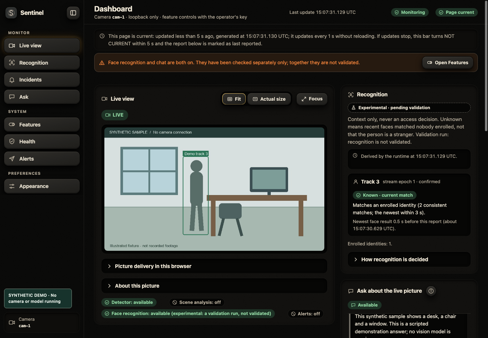
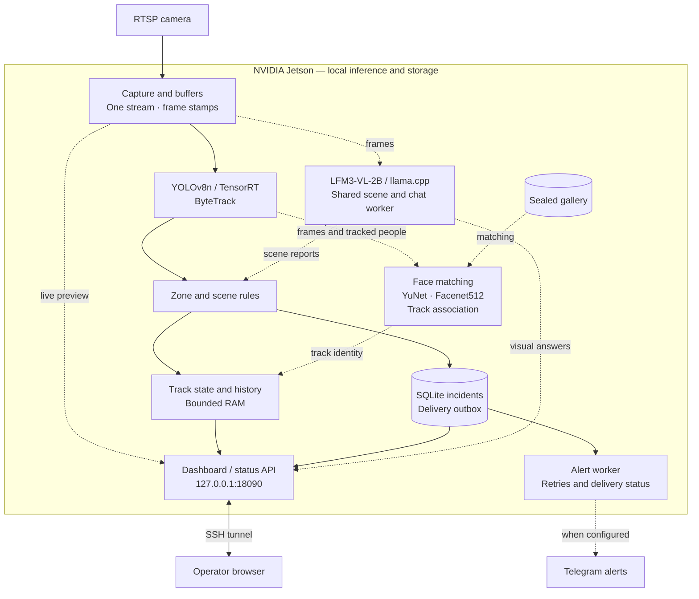

<div align="center">

```
███████╗███████╗███╗   ██╗████████╗██╗███╗   ██╗███████╗██╗     
██╔════╝██╔════╝████╗  ██║╚══██╔══╝██║████╗  ██║██╔════╝██║     
███████╗█████╗  ██╔██╗ ██║   ██║   ██║██╔██╗ ██║█████╗  ██║     
╚════██║██╔══╝  ██║╚██╗██║   ██║   ██║██║╚██╗██║██╔══╝  ██║     
███████║███████╗██║ ╚████║   ██║   ██║██║ ╚████║███████╗███████╗
╚══════╝╚══════╝╚═╝  ╚═══╝   ╚═╝   ╚═╝╚═╝  ╚═══╝╚══════╝╚══════╝
```

**Sentinel v2: edge monitoring for one camera on an NVIDIA Jetson**
*Person detection and tracking · zone rules · incidents and alerts · a local dashboard ·
face recognition and scene analysis under validation*


[](https://hemkesh2021-dotcom.github.io/sentinel-site/)

</div>

## Explore Sentinel in your browser

**[Understand the project](https://hemkesh2021-dotcom.github.io/sentinel-site/)** ·
**[Try the interactive dashboard](https://hemkesh2021-dotcom.github.io/sentinel-site/dashboard.html)**

The project site explains how a camera observation becomes a local incident and shows the hardware and processing flow.
The interactive demo lets you explore incidents, the Ask panel, appearance settings and scripted scenarios such as
an arrival, retained identity and a stalled stream — **no Jetson, installation or camera is needed**.
It uses synthetic scenes and scripted answers; it demonstrates the interface, not recognition accuracy or live model performance.
For a real device, continue with the [beta installer](#install-on-your-own-jetson-tester-package-experimental)
and [Wiki](https://github.com/hemkesh2021-dotcom/Sentinel_Surveillance/wiki).

## Dashboard preview



Recorded from the beta.1 dashboard with synthetic demonstration data. No camera or model was running;
the example status, incidents and answers illustrate the interface, not measured recognition or model performance.

<details>
<summary>View still screenshots in light and dark mode</summary>

### Light mode



### Dark mode



</details>

## Try it

| If you have | Do this |
|---|---|
| A browser | Open the [project website](https://hemkesh2021-dotcom.github.io/sentinel-site/): a hardware tour and a [demo dashboard](https://hemkesh2021-dotcom.github.io/sentinel-site/dashboard.html) running the real dashboard code on a scripted scene. No device is involved. |
| Any computer with Python 3.10+ | Clone the beta, run `pip install -e '.[dev]'`, then `pytest` ([Portable development](#portable-development-ci-runs-on-every-push)). No camera, GPU or model needed. |
| A Jetson Orin Nano | Try the experimental [tester package](packaging/beta-install/QUICKSTART.md), and report problems with the [installation issue form](https://github.com/hemkesh2021-dotcom/Sentinel_Surveillance/issues/new?template=installation-issue.md). |

## Read more

- [Your slowest model shouldn't make your fastest decisions: lessons from an edge AI camera on a Jetson](https://dev.to/hemkesh2021dotcom/your-slowest-model-shouldnt-make-your-fastest-decisions-lessons-from-an-edge-ai-camera-on-a-jetson-5ep6) (dev.to; also on [Hashnode](https://hemkesh.hashnode.dev/slowest-model-fastest-decisions-edge-ai-jetson))

---

> **Current release: [Sentinel v2.0.0-beta.1](https://github.com/hemkesh2021-dotcom/Sentinel_Surveillance/releases/tag/v2.0.0-beta.1)**,
> published 16 November 2026, with revision 9 of the tester installation package.
> **The beta name is a release designation, not a validation result.** Face recognition, identity retention and chat
> retain their experimental validation status; the release is not production-accepted.
>
> Start with [Install on your own Jetson](#install-on-your-own-jetson-tester-package-experimental) or the
> [Wiki](https://github.com/hemkesh2021-dotcom/Sentinel_Surveillance/wiki).
> One earlier installer revision completed a camera-free build rehearsal on the reference Jetson; the later changes
> were checked offline. A complete launch from the package and another Jetson remain unverified.
> [Status and limitations](https://github.com/hemkesh2021-dotcom/Sentinel_Surveillance/wiki/Status-and-limitations)
> separates implementation, operator observations and formal validation.

## New in beta.1

- **Tester installer:** pinned downloads, guarded device builds, your own enrollment and device-artifacts record,
  manual launch, clean stop and uninstall.
- **LFM3-VL-2B scene analysis and visual chat**, through the pinned llama.cpp build.
- **Identity retention:** an established identity can be retained on the same continuous track life, with explicit
  expiry and clearing conditions; raw matching thresholds are unchanged.
- **A more useful Ask panel:** supported records questions, follow-ups, reanalysis, opt-in automatic refresh,
  crop-based zoom and a scan of one held picture's visible regions. Its conversation scrolls within the panel.
- **Settings:** browser-local appearance and operator-key-protected runtime controls in one dialog.
- **r9 correction:** the Ask conversation keeps following the newest exchange while its list is resized.

See the [beta release notes](docs/RELEASE_NOTES_v2.0.0-beta.1.md) for the exact changes and checks,
[dashboard guide](https://github.com/hemkesh2021-dotcom/Sentinel_Surveillance/wiki/Dashboard-and-controls) for use,
and [version history](#earlier-releases) for the preserved alpha and v1 releases.

## Overview

Sentinel watches one camera from an NVIDIA Jetson Orin Nano. It detects and tracks people, applies zone rules, opens
incidents in a local SQLite database and delivers alerts through a restart-safe outbox. A dashboard on the device's
loopback address shows the live picture, the incidents with their snapshots and, in validation runs, face recognition
per tracked person. Face recognition (DeepFace with Facenet512 and YuNet) and scene analysis with a local
vision-language model (LFM3-VL-2B through llama.cpp's `llama-server`) are optional lanes. They run only when the
configuration lists their adapters as admitted, or in guarded validation runs.

v2 is a rewrite of the v1 prototype as a tested package (`src/sentinel/`, command `sentinel`). Every observation
carries its frame's source time, the boot and the stream epoch. Stale or mismatched results never drive a current
decision. A face is associated with at most one person, and an unknown face is never called a stranger. Fire or smoke
from the scene model alone is never a critical alarm. Empty, fresh, stale and offline states are published
explicitly.

## Architecture



Solid arrows show the core data flow; dashed arrows show optional paths. Face recognition and visual chat retain
their experimental admission status. The preview reuses captured frames; it does not open another camera connection.

- **Two Ask paths:** visual questions use the shared local scene model, with scene monitoring taking priority and
  chat bounded and cancellable. Questions about recorded activity use current track state, bounded RAM history and
  read-only SQLite queries; that path does not call the model.
- **Controls:** appearance stays in the browser. Operator-key-protected feature controls pause or resume the
  runtime's available lanes.
- **Guarded sessions:** the validation launcher supervises the runtime with the memory guard. This is an external
  supervisor for those sessions, not an always-running component of every installation.

| Area | Package path |
|---|---|
| Capture, frame identity, freshness | `src/sentinel/media/` |
| Person detection and tracking | `src/sentinel/inference/`, `src/sentinel/tracking/` |
| Zone and schedule rules, scene hazards | `src/sentinel/rules/` |
| Incidents, snapshots, the database | `src/sentinel/incidents/`, `src/sentinel/storage/` |
| Alert outbox and Telegram | `src/sentinel/alerts/` |
| Face association, sealed gallery, matching | `src/sentinel/identity/` |
| Scene analysis, llama-server, chat | `src/sentinel/scene/` |
| Status page and dashboard | `src/sentinel/status_page.py`, `src/sentinel/web/` |
| The runtime and the command line | `src/sentinel/demo_runtime.py`, `src/sentinel/runtime.py`, `src/sentinel/cli.py` |
| Operator check tooling (memory guard, readings) | `benchmarks/runner/` |

Device-only libraries (TensorRT, CUDA, DeepFace, OpenCV) are imported only when a device lane starts, so the package,
its configuration checks and its tests run on any machine.

## Feature status

Updated for **v2.0.0-beta.1**, 17 November 2026. Implemented behavior, a successful observation and formal
acceptance are different claims.

| Feature | Implemented and checked | Availability and remaining limits |
|---|---|---|
| Detection, tracking, zone rules, incidents and alert outbox | Portable tests; bounded reference-device checks, including one real Telegram send | Core monitoring; no production acceptance |
| Dashboard, live preview and incident details | Browser tests and reference-device observations; light/dark appearance and Settings | Preview is opt-in; snapshots and notifications are off in the tester profile |
| Face recognition | YuNet / Facenet512, track association and single-person observations; satisfactory behavior reported by the maintainer on 11 November | Validation runs only; F2 has never passed, false-acceptance data and multiple-person testing are pending |
| Identity retention | Separate established-identity ledger, bounded by track life, evidence and time; regression tests and operator feedback | Opt-in `--identity-retention`; proposed values, not validated wrong-identity retention rates |
| Visual Ask, follow-ups, refresh, zoom and scan | Local LFM3 model path with scene priority, bounded held frames and cancellation; offline/browser checks and operator feedback | Chat remains not admitted; answer accuracy and combined formal validation are pending |
| Ask from records | Supported questions use track state, bounded RAM history and read-only incident/delivery queries; coverage and gaps are stated | Shares chat availability; no model inference on this path and no arbitrary database queries |
| Scene analysis | Capped LFM3 profile and guarded integration observations on the reference device | Requires the configured admitted profile or validation route; no general device/resource guarantee |
| Runtime feature controls | Same-origin/page-token protections and operator key; pause/resume the run's existing lanes | Opt-in; controls do not load or admit new features |
| Tester installer r9 | r5 completed a camera-free build rehearsal on one device; later changes and r9 archive checks were offline | Complete package launch, package enrollment, stock JetPack and another Jetson are unverified |

The default face-vote rule is unchanged. With retention enabled, **Known · current match** and **Known · retained**
are distinct: a numeric track ID alone never establishes continuity. The model cannot establish a person's identity;
supported “who” questions report the system's recognition records.

Face, scene and chat **have run together** in guarded reference-device observations. In the capped LFM3 integration
check, execution, recognition-execution and memory passed, but the overall reading did not pass because cancellation
was not exercised. A separate cancellation check is separate evidence. The
[Wiki status page](https://github.com/hemkesh2021-dotcom/Sentinel_Surveillance/wiki/Status-and-limitations) and
[session record](docs/IMPLEMENTATION_STATUS.md) preserve those limits.

## Getting started

### Portable development (CI runs on every push)

Python 3.10 or newer. No camera, GPU or model is needed. A pre-release tag is placed only on a commit whose CI passed
(Dashboard checks; v2 portable checks on Python 3.10 and 3.12). On the commit the release's archive was built from,
`5a1238a`, CI ran the whole suite under both versions: 4,224 passed, 78 skipped in each
([Dashboard checks](https://github.com/hemkesh2021-dotcom/Sentinel_Surveillance/actions/runs/43871694511),
[v2 portable checks](https://github.com/hemkesh2021-dotcom/Sentinel_Surveillance/actions/runs/43871694570)). Locally on
the device, not CI: the full offline suite passed once under Python 3.10 at `1fac8d6` (3,931 passed, 7 skipped); the
commits after it ran the test files they affect.

```bash
git clone --branch v2.0.0-beta.1 https://github.com/hemkesh2021-dotcom/Sentinel_Surveillance.git
cd Sentinel_Surveillance
python -m venv .venv && . .venv/bin/activate
python -m pip install -e '.[dev]'
python -m pytest                              # browser tests run when a Chromium-family browser is found
sentinel config validate config/default.yaml  # checks a configuration file
sentinel --version                            # sentinel 2.0.0b1
```

### Install on your own Jetson (tester package, experimental)

The pre-release carries one archive, revision 9 of the package, and its `.sha256` file
([releases](https://github.com/hemkesh2021-dotcom/Sentinel_Surveillance/releases)). It installs under your own
account, without sudo, downloads the pinned Python packages and model files from their upstream sources, and builds
llama.cpp and the detector engine on your device. Its guide is
[`packaging/beta-install/QUICKSTART.md`](packaging/beta-install/QUICKSTART.md) (also inside the archive, with a
`README.md`).

| | |
|---|---|
| Archive | `sentinel-personal-beta-949da67-mod960fcc3-r9.tar.gz` |
| Size, files | 722,378 B; 126 files |
| SHA-256 | `3b5dde56d1926d6be5391bf8a49c313ca952f8693452c56ebf334bf3929f2d1c` |
| Built from | commit `5a1238a10d764b54a184969734715298338bf43d`, by `packaging/build_archive.py` |

```bash
sha256sum -c sentinel-personal-beta-949da67-mod960fcc3-r9.tar.gz.sha256   # then extract it and read README.md and QUICKSTART.md
```

Before you start:

- **What ran, and what did not.** Revision 5 of the package completed a camera-free build rehearsal on the reference
  device (installation, environment, downloads, both builds, the record of the built files and its verification).
  The packaging changes of revision 6 and the documents, licence files and version string of revisions 7 and 8
  were checked offline only. Revision 9, this archive, differs from revision 8 in one file of the application, the
  dashboard's script (the Ask panel's conversation while a window is resized), which was checked in a test browser
  only. The archive itself was installed, checked and uninstalled in a scratch folder on the reference device,
  without network, camera, model or build. **A complete launch from the package has never been made, and no other
  Jetson has run it.**
- **The default check and launch refuse on your device.** They admit only the reference device's own files. Your
  files are used only through the opt-in `--device-artifacts` route, for experimental validation runs; it validates
  nothing about your device's memory, speed or stability (resource validation is pending).
- **Stock JetPack is unverified.** The reference device runs L4T R36.4.7 with an Ubuntu 24.04 userland. On stock
  JetPack 6 the installer goes on only with `--accept-unverified-platform`.
- **You supply your own** camera, configuration, enrollment (photos of yourself, sealed with your passphrase) and
  device artifacts. Nobody's gallery, credentials, models, engine or recordings are in the archive.
- **Face data and the camera.** Only `identity.sh enroll` reads your photos, and only `start.sh`, after you type
  START, opens the camera. The guide's section 12 lists every step.
- **Licences.** The archive holds Sentinel's own files (MIT). What it downloads keeps its own licences, among them
  AGPL-3.0 and the LFM Open License v1.0:
  [`THIRD_PARTY_NOTICES.md`](packaging/beta-install/THIRD_PARTY_NOTICES.md).

Problems go to the [installation issue form](https://github.com/hemkesh2021-dotcom/Sentinel_Surveillance/issues/new?template=installation-issue.md).

### Choose the right device guide

For a new tester installation, use the [tagged installer guide](https://github.com/hemkesh2021-dotcom/Sentinel_Surveillance/blob/v2.0.0-beta.1/packaging/beta-install/QUICKSTART.md).
It covers prerequisites, memory preparation, guarded builds, enrollment, artifact checks, the SSH tunnel and clean stop.
**The launch's final START prompt is the step that permits the camera to open.**

[`docs/BETA_QUICKSTART.md`](docs/BETA_QUICKSTART.md) records the maintainer's separate private launcher and existing
device setup. It is not an installation recipe for another account. The root `BUILD.md`, `SETUP_GUIDE.txt` and v1
scripts are legacy documentation/code, not the v2 tester installation path.

## Data and privacy

- Credentials (the camera URL, the Telegram token, the gallery passphrase) come from the environment and are never
  written to the repository or the database. Configuration files must hold none.
- The face gallery is sealed with a passphrase, needs recorded consent to enroll, and can be revoked and purged
  (`sentinel identity`). Face embeddings are biometric data.
- The gallery holds no names. Dashboard labels are anonymous by default; optional operator-configured display labels
  can appear in records answers. Face recognition is context only: it never grants or denies anything.
- Never commit galleries, photos, footage, run evidence or credentials.

## Repository layout

| Path | What it is |
|---|---|
| `src/sentinel/`, `tests/`, `config/`, `pyproject.toml` | Sentinel v2 |
| `benchmarks/runner/` | v2 operator check tooling (memory guard, readings of saved evidence) |
| `packaging/` | the tester installation package (`beta-install/`) and the tool that builds its archive |
| `docs/` | v2 status record, requirements trace, alpha notes, release notes, legacy v1 README |
| `surveillance4_1.py`, `dashboard.py`, `build_face_db.py`, `start_sentinel.sh`, `requirements.txt`, `.env.example`, `BUILD.md`, `SETUP_GUIDE.txt`, `tests/test_dashboard.py` | legacy v1; the setup guides carry v2 navigation notices; see [`docs/LEGACY_V1.md`](docs/LEGACY_V1.md) |

## Earlier releases

`master` now carries v2 development and current documentation. Use release tags for an exact historical version:

| Release | Source |
|---|---|
| [v2.0.0-beta.1](https://github.com/hemkesh2021-dotcom/Sentinel_Surveillance/releases/tag/v2.0.0-beta.1) | [Tagged beta source](https://github.com/hemkesh2021-dotcom/Sentinel_Surveillance/tree/v2.0.0-beta.1) |
| [v2.0.0-alpha.2](https://github.com/hemkesh2021-dotcom/Sentinel_Surveillance/releases/tag/v2.0.0-alpha.2) | [Tagged alpha.2 source](https://github.com/hemkesh2021-dotcom/Sentinel_Surveillance/tree/v2.0.0-alpha.2) |
| [v2.0.0-alpha.1](https://github.com/hemkesh2021-dotcom/Sentinel_Surveillance/releases/tag/v2.0.0-alpha.1) | [Tagged alpha.1 source](https://github.com/hemkesh2021-dotcom/Sentinel_Surveillance/tree/v2.0.0-alpha.1) |
| [v1.1.0](https://github.com/hemkesh2021-dotcom/Sentinel_Surveillance/releases/tag/v1.1.0) | [Legacy guide](docs/LEGACY_V1.md); GitHub's latest stable release |

The obsolete candidate branches were removed after their commits were included in `master`.
The alpha tags, releases and source downloads are preserved; link to those instead of deleted branch names.

## Maintainer

V2 maintainer: Hemkesh ([@hemkesh2021-dotcom](https://github.com/hemkesh2021-dotcom)).
Historical v1 contributor credits are kept in [`docs/LEGACY_V1.md`](docs/LEGACY_V1.md#authors).

## License

Sentinel's own code is under the MIT License: see [`LICENSE`](LICENSE). Third-party software and model files are not
part of this repository and keep their own licences; the tester package's
[`THIRD_PARTY_NOTICES.md`](packaging/beta-install/THIRD_PARTY_NOTICES.md) lists the ones it downloads.

This project is for personal / educational use. Do not deploy in public spaces without complying with local privacy
laws — face embeddings are **biometric data** (see DPDP / GDPR / BIPA).

> Note: YOLOv8 / Ultralytics is **AGPL-3.0**. Any closed-source or commercial deployment requires either open-sourcing
> the derived work or an Ultralytics commercial license.
